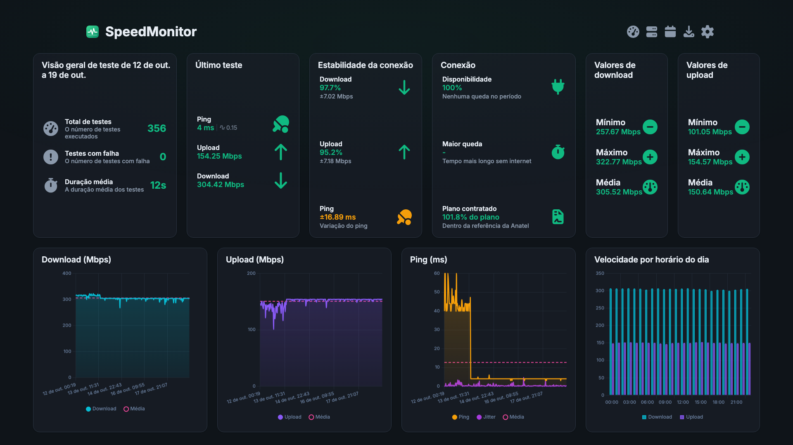
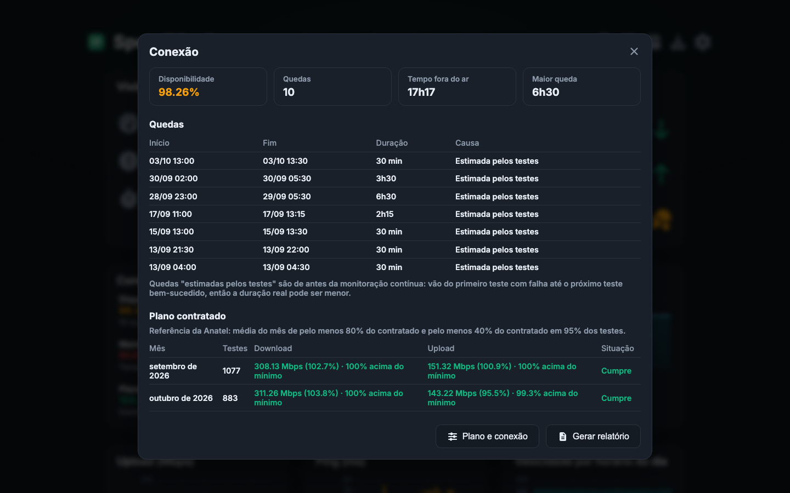
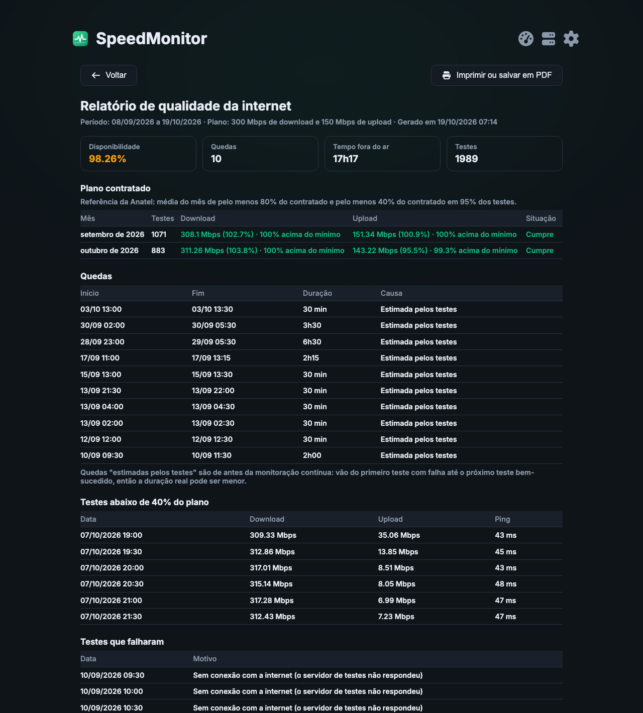
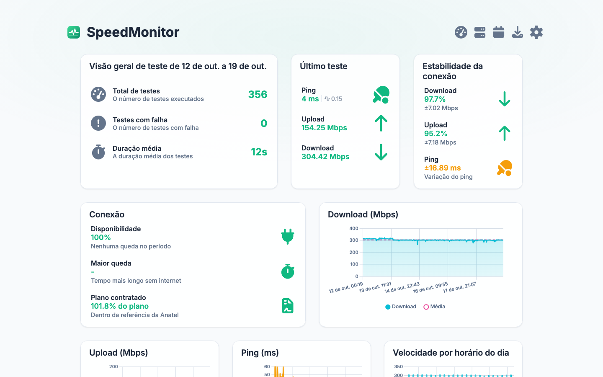
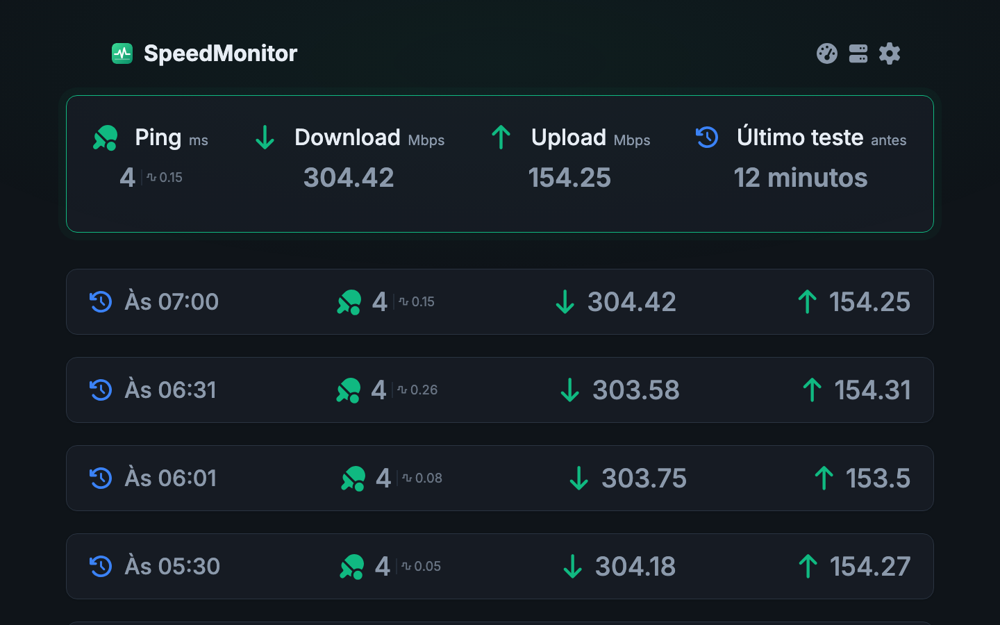
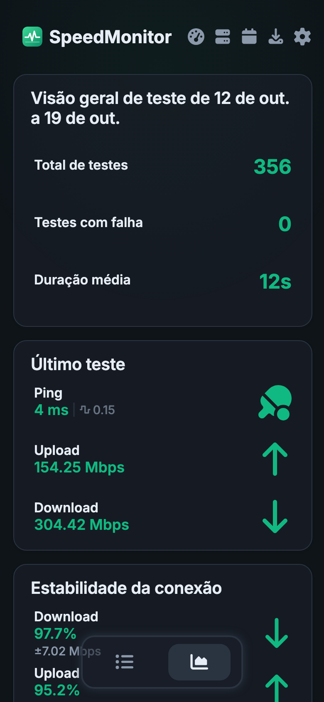

<div align="center">
  
  <h1>SpeedMonitor</h1>
  <p>Acompanhe a velocidade e as quedas da sua internet ao longo do tempo.</p>
</div>



## O que é

O SpeedMonitor roda testes de velocidade automaticamente (download, upload, ping e jitter), guarda o histórico e mostra tudo em gráficos e estatísticas. Entre um teste e outro, ele confere a conexão a cada 30 segundos para registrar cada queda. Com isso dá para saber quando a internet caiu, por quanto tempo, em que horário ela fica lenta e se a operadora entrega a velocidade contratada.

## Recursos

- **Estatísticas como página inicial**: download, upload, ping, estabilidade, médias por horário e um resumo da conexão
- **Registro de quedas**: início, fim e duração de cada queda, e a disponibilidade do período. Com o endereço do roteador configurado, ele também indica se a queda foi do provedor ou da rede de casa
- **Plano contratado**: compara a velocidade medida com o plano, mês a mês, usando a referência da Anatel (média de pelo menos 80% do contratado e pelo menos 40% em 95% dos testes)
- **Relatório para imprimir ou salvar em PDF**, com quedas, testes abaixo do mínimo e testes que falharam. Serve de base para uma reclamação na operadora ou na Anatel
- **Avisos em português** por Telegram, ntfy, Discord, Gotify, Pushover ou webhook: quando a internet volta depois de uma queda, quando a velocidade fica abaixo do plano e ao fim de cada teste
- **Lista completa dos testes**, seletor de período e exportação em CSV e JSON
- **Testes agendados** com servidores Ookla, LibreSpeed ou Cloudflare
- **Tema claro e escuro**, layout que aproveita telas grandes e se ajusta ao celular
- **Várias instâncias** num painel só e **métricas para Prometheus e Grafana**

## Telas

### Conexão: quedas e plano contratado

Clique no card **Conexão** para ver cada queda e se o plano foi cumprido em cada mês.



### Relatório de qualidade

Em **Gerar relatório**, o período escolhido vira uma página pronta para imprimir ou salvar em PDF.



### Tema claro



### Lista de testes



### No celular



## Como rodar

Com Docker:

```bash
docker build -t speedmonitor .
docker run -d --name speedmonitor \
  -p 5216:5216 \
  -e TZ=America/Sao_Paulo \
  -v /caminho/para/os/dados:/app/data \
  --restart unless-stopped \
  speedmonitor
```

Depois, abra `http://IP-DO-SERVIDOR:5216`. Os dados (banco e configurações) ficam na pasta mapeada em `/app/data`, então dá para recriar o contêiner sem perder o histórico. Ajuste o `TZ` para o seu fuso, para que os horários dos avisos saiam certos.

## Primeiros ajustes

1. **Plano e conexão** (em Configurações): informe o download e o upload contratados e o endereço do roteador, por exemplo `192.168.1.1`.
2. **Integrações** (em Configurações): escolha onde receber os avisos e ligue "Avisar quando a internet cair". O jeito mais simples é o [ntfy](https://ntfy.sh): instale o app no celular, escolha um tópico e use `https://ntfy.sh` como servidor.
3. **Definir frequência**: com o registro de quedas ligado, dá para espaçar os testes completos (por exemplo, a cada 2 horas) e gastar menos internet sem perder as quedas.

## Licença

Distribuído sob a licença MIT. Veja o arquivo [`LICENSE`](LICENSE).
