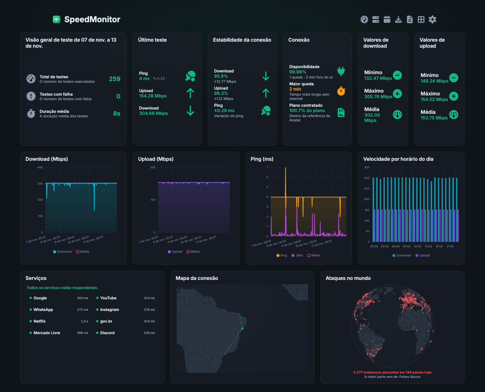
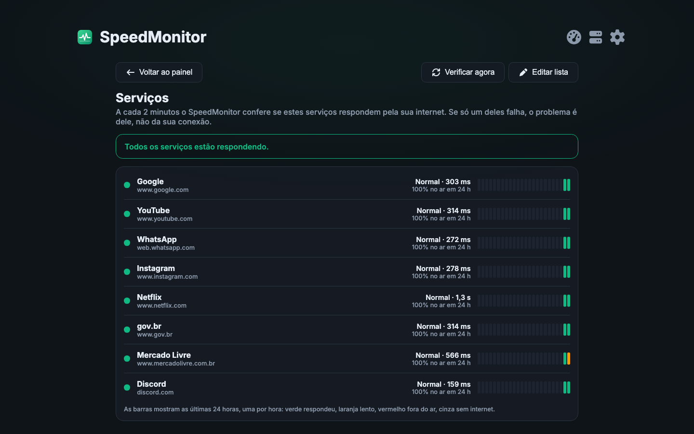
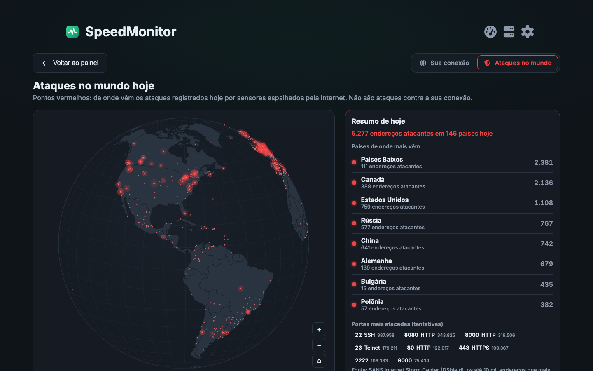
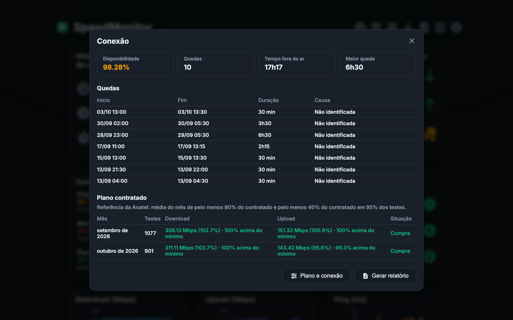
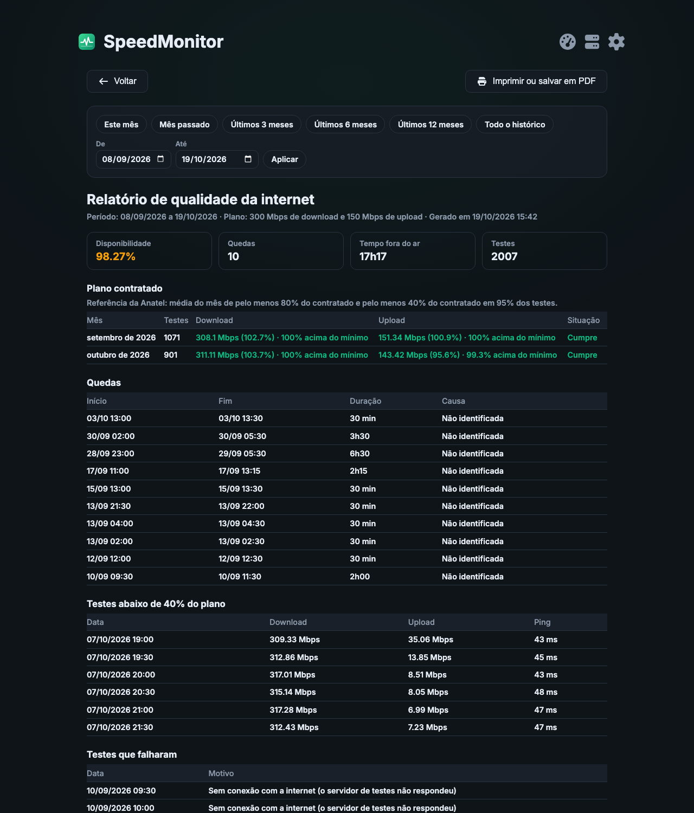
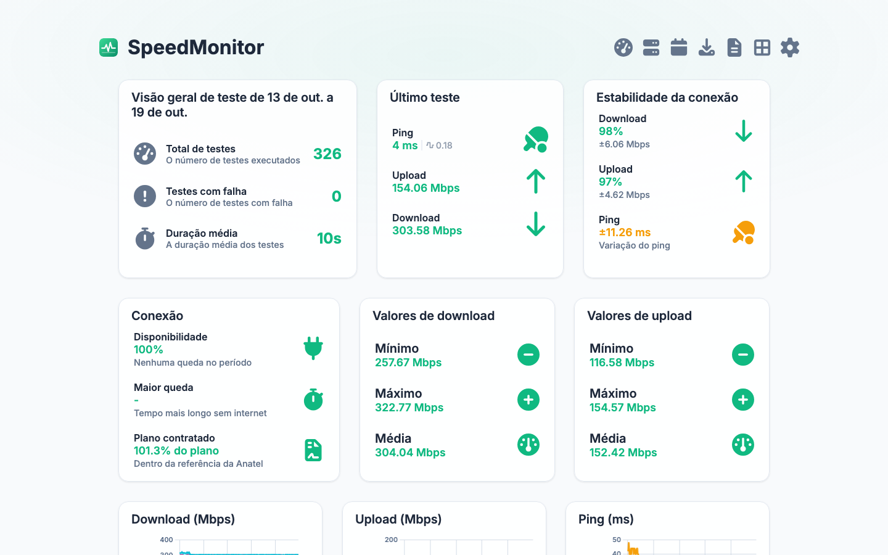
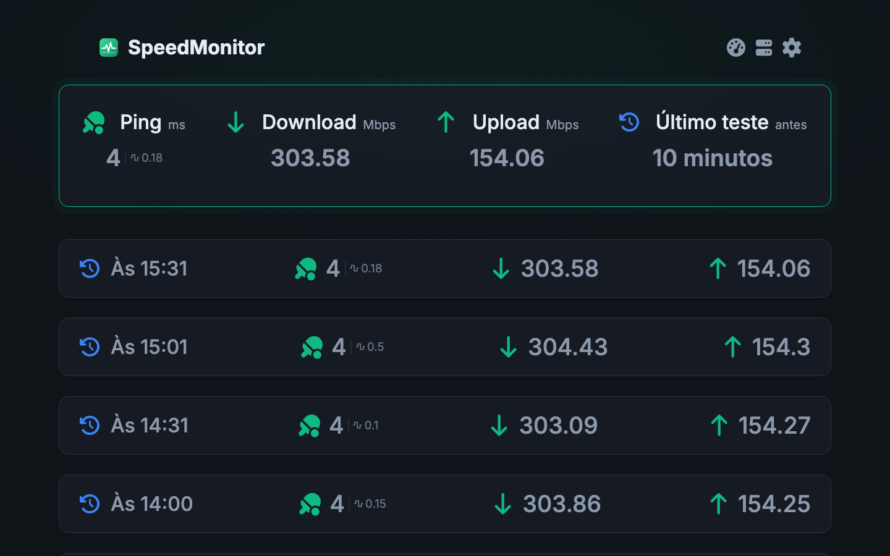
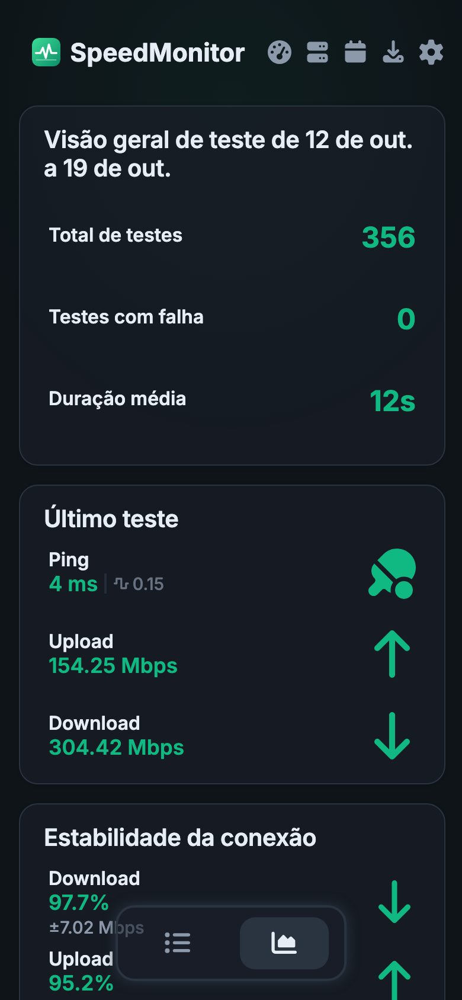

<div align="center">
  
  <h1>SpeedMonitor</h1>
  <p>Acompanhe a velocidade e as quedas da sua internet ao longo do tempo.</p>
</div>



## O que é

O SpeedMonitor roda testes de velocidade automaticamente (download, upload, ping e jitter), guarda o histórico e mostra tudo em gráficos e estatísticas. Entre um teste e outro, ele confere a conexão a cada 30 segundos para registrar cada queda. Com isso dá para saber quando a internet caiu, por quanto tempo, em que horário ela fica lenta e se a operadora entrega a velocidade contratada.

Ele também confere se serviços como WhatsApp, YouTube e Netflix estão respondendo, para separar "a internet caiu" de "só esse serviço caiu", e mostra num globo para onde vai a sua internet e de onde vêm os ataques registrados no mundo.

## Recursos

- **Estatísticas como página inicial**: download, upload, ping, estabilidade, médias por horário e um resumo da conexão, além de um gráfico com download, upload, ping e jitter juntos para ver se eles mudam ao mesmo tempo
- **Registro de quedas**: início, fim e duração de cada queda, e a disponibilidade do período. Com o endereço do roteador configurado, ele também indica se a queda foi do provedor ou da rede de casa
- **Plano contratado**: compara a velocidade medida com o plano, mês a mês, usando a referência da Anatel (média de pelo menos 80% do contratado e pelo menos 40% em 95% dos testes)
- **Relatório para imprimir ou salvar em PDF**, com quedas, testes abaixo do mínimo e testes que falharam. Serve de base para uma reclamação na operadora ou na Anatel
- **Avisos em português** por Telegram, ntfy, Discord, Gotify, Pushover ou webhook: quando a internet volta depois de uma queda, quando a velocidade fica abaixo do plano e ao fim de cada teste
- **Lista completa dos testes**, seletor de período e exportação em CSV e JSON
- **Testes agendados** com servidores Ookla, LibreSpeed ou Cloudflare
- **Serviços fora do ar**: a cada 2 minutos confere se WhatsApp, YouTube, Instagram, Netflix, gov.br e outros respondem. Diz se o problema é do serviço ou da sua internet, avisa quando um serviço está mais lento que o normal e mostra as últimas 24 horas de cada um. A lista é editável
- **Mapa da conexão**: um globo com de onde respondem os serviços e os servidores de teste. A cidade vem do nome do servidor, da Cloudflare ou do endereço; quando não há pista, é estimada pelo tempo de resposta e aparece marcada como estimada
- **Ataques no mundo**: um globo com de onde vêm os ataques registrados hoje por sensores espalhados pela internet (SANS DShield), por cidade e por país, e as portas mais atacadas. Não são ataques contra a sua conexão
- **Painel personalizável**: arraste os cards para mudar a ordem, puxe o canto para mudar a largura e a altura, e oculte o que não quiser ver (botão de grade no cabeçalho ou Configurações → Personalizar painel). Celular, notebook e computador guardam cada um o seu layout, e no celular dá para arrastar com o dedo (toque e segure)
- **Tema claro e escuro**, layout que aproveita telas grandes e se ajusta ao celular
- **Várias instâncias** num painel só, cada uma com o nome que você der nas Preferências, e **métricas para Prometheus e Grafana**
- **Add-on para o Home Assistant** no repositório [guslma/homeassistant-addons](https://github.com/guslma/homeassistant-addons)

## Telas

### Serviços

Clique no card **Serviços** para ver cada serviço, o tempo de resposta e as últimas 24 horas. Os que caíram ou estão mais lentos que o normal aparecem no topo do card.



### Ataques no mundo

Clique no card **Ataques no mundo** para abrir o globo com os países e as portas mais atacadas. Arraste para virar o globo e use a roda do mouse ou os botões para aproximar.



### Conexão: quedas e plano contratado

Clique no card **Conexão** para ver cada queda e se o plano foi cumprido em cada mês.



### Relatório de qualidade

Em **Gerar relatório**, o período escolhido abre num modal pronto para imprimir ou salvar em PDF. Na impressão sai só o relatório.



### Tema claro



### Lista de testes



### No celular



## Como instalar

Funciona em qualquer máquina Linux que fique ligada, como um mini PC, um Raspberry Pi ou um servidor caseiro, e dá para fazer tudo pelo terminal.

**1. Instale o Docker** (pule se já tiver):

```bash
curl -fsSL https://get.docker.com | sudo sh
```

**2. Inicie o SpeedMonitor** com a imagem pronta:

```bash
sudo docker run -d --name speedmonitor \
  -p 5216:5216 \
  -e TZ=America/Sao_Paulo \
  -v ~/speedmonitor-data:/app/data \
  --restart unless-stopped \
  ghcr.io/guslma/speedmonitor:latest
```

Pronto, pule para o passo 4. A imagem funciona em computadores comuns (amd64) e em Raspberry Pi e outros ARM de 64 bits (arm64).

Se preferir gerar a imagem a partir do código:

**2b. Baixe o código e gere a imagem:**

```bash
git clone https://github.com/guslma/SpeedMonitor.git
cd SpeedMonitor
sudo docker build -t speedmonitor .
```

Sem `git`, baixe o código assim:

```bash
curl -L https://github.com/guslma/SpeedMonitor/archive/refs/heads/main.tar.gz | tar xz
cd SpeedMonitor-main
```

Gerar a imagem leva alguns minutos e baixa algumas centenas de MB. Num Raspberry Pi, demora mais.

**3. Inicie o SpeedMonitor:**

```bash
sudo docker run -d --name speedmonitor \
  -p 5216:5216 \
  -e TZ=America/Sao_Paulo \
  -v ~/speedmonitor-data:/app/data \
  --restart unless-stopped \
  speedmonitor
```

- `TZ` é o fuso horário, usado nos horários dos avisos e do relatório.
- `~/speedmonitor-data` é onde ficam o banco e as configurações, então dá para recriar o contêiner sem perder o histórico.
- `--restart unless-stopped` faz ele voltar sozinho depois que a máquina reinicia.

**4. Abra no navegador:** `http://IP-DA-MÁQUINA:5216`, de qualquer aparelho da mesma rede. Para descobrir o IP, rode `hostname -I` na máquina. Na primeira vez, um assistente pede para escolher o servidor de testes.

### Atualizar

Com a imagem pronta:

```bash
sudo docker pull ghcr.io/guslma/speedmonitor:latest
sudo docker rm -f speedmonitor
```

Depois, rode de novo o comando do passo 2. Se você gerou a imagem a partir do código:

```bash
cd SpeedMonitor
git pull
sudo docker build -t speedmonitor .
sudo docker rm -f speedmonitor
```

Depois, rode de novo o comando do passo 3. Nos dois casos, o histórico continua em `~/speedmonitor-data`.

### Acessar de fora de casa

A página só abre na rede local. Para ver de outro lugar, o jeito mais simples é instalar o [Tailscale](https://tailscale.com) na máquina e no seu celular ou computador. Não precisa abrir portas no roteador.

## Primeiros ajustes

1. **Plano e conexão** (em Configurações): informe o download e o upload contratados e o endereço do roteador, por exemplo `192.168.1.1`. Para descobrir o endereço do roteador, rode `ip route | grep default` na máquina.
2. **Integrações** (em Configurações): escolha onde receber os avisos e ligue "Avisar quando a internet cair". O jeito mais simples é o [ntfy](https://ntfy.sh): instale o app no celular, escolha um tópico e use `https://ntfy.sh` como servidor.
3. **Definir frequência**: cada teste completo gasta algumas centenas de MB. Como as quedas são registradas à parte, dá para espaçar os testes (por exemplo, a cada 2 horas) e gastar menos internet sem perder nenhuma queda. Isso vale a pena principalmente em internet com franquia.

## Serviços externos

Além do servidor de testes escolhido, o SpeedMonitor consulta:

- **SANS Internet Storm Center (DShield)**, para os ataques no mundo, uma vez por hora
- **[ip-api.com](https://ip-api.com)**, para localizar os endereços dos serviços, dos servidores de teste e dos atacantes. Vão só esses endereços; as respostas ficam guardadas por uma semana
- **[DB-IP](https://db-ip.com)**: a lista gratuita de país por endereço é baixada uma vez por mês e consultada no próprio servidor. IP Geolocation by DB-IP, licença [CC BY 4.0](https://creativecommons.org/licenses/by/4.0/)
- **Cloudflare** (`1.1.1.1/cdn-cgi/trace`), para saber de qual cidade a Cloudflare atende a sua conexão

A verificação de serviços pode ser desligada na página **Serviços**.

## Licença

Distribuído sob a licença MIT. Veja o arquivo [`LICENSE`](LICENSE).
